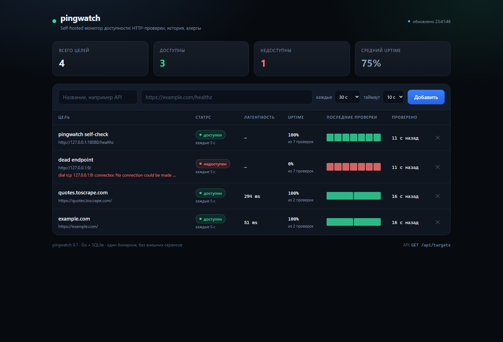

# pingwatch

[](https://github.com/Hopfi3721/pingwatch/actions/workflows/ci.yml)
[](https://github.com/Hopfi3721/pingwatch/releases)
[](LICENSE)
[](go.mod)

[Русский](README.md) | **English**

An uptime monitor in Go: it periodically checks HTTP endpoints, keeps a latency
history and sends a Telegram alert when a service actually goes down — once, not
every 30 seconds.



One binary and one SQLite file. No Docker, Postgres, Redis or external CDNs
required — it starts with `go run ./cmd/pingwatch`.

## Features

- **HTTP checks** — 2xx/3xx count as success, 4xx/5xx and network errors count as
  failure; status code, latency and error text are stored
- **Per-target schedule** — interval from 5 seconds to a day, separate timeout
- **Worker pool** — a slow site occupies one worker and does not hold up the rest
- **History and stats** — uptime, average latency, p95, recent checks
- **Alerts without spam** — a state machine notifies only on `up → down`
  (after N consecutive failures) and `down → up`
- **Telegram and log** — the same text goes to every channel
- **Survives restarts** — alert state is restored from the latest results, so no
  repeated DOWN after a restart
- **Dashboard** — embedded into the binary, refreshes every 5 seconds, loads
  nothing from the internet
- **History cleanup** — the last 5000 results per target are kept
- **Graceful shutdown** — server and workers stop on `Ctrl+C`

## Quick start

```bash
go run ./cmd/pingwatch
```

Open <http://localhost:8080> and add your first URL. The first check runs within
a second.

### Prebuilt binary

Download an archive for your OS from the [releases](https://github.com/Hopfi3721/pingwatch/releases)
page, unpack and run:

```bash
./pingwatch            # Linux / macOS
./pingwatch.exe        # Windows
./pingwatch --version  # build version
```

### Docker

```bash
docker compose up --build
```

Or use the image from GitHub Container Registry:

```bash
docker run -p 8080:8080 -v pingwatch-data:/data ghcr.io/hopfi3721/pingwatch:latest
```

Or build it yourself:

```bash
docker build -t pingwatch .
docker run -p 8080:8080 -v pingwatch-data:/data pingwatch
```

## Telegram alerts

1. Create a bot via [@BotFather](https://t.me/BotFather) → `/newbot` → get a token.
2. Send the bot any message and read `chat_id` from
   `https://api.telegram.org/bot<TOKEN>/getUpdates` → `result[0].message.chat.id`.
3. Set the environment variables:

```bash
export TELEGRAM_BOT_TOKEN="123456:ABC..."
export TELEGRAM_CHAT_ID="123456789"
export FAILURE_THRESHOLD="3"
go run ./cmd/pingwatch
```

The token is read from the environment only. Never commit it; if it leaks, revoke
it via `@BotFather` → **Revoke token**.

A down alert contains the target name, URL, HTTP code, error text, the number of
consecutive failures, latency and timestamp. Recovery produces a separate
`RECOVERED` message.

## API

| Method | Path | Description |
| :--- | :--- | :--- |
| `GET` | `/` | Embedded dashboard |
| `GET` | `/healthz` | Liveness check of pingwatch itself |
| `GET` | `/api/targets` | All targets with the latest result |
| `POST` | `/api/targets` | Create a target |
| `GET` | `/api/targets/{id}` | Target with the latest result |
| `DELETE` | `/api/targets/{id}` | Delete a target together with its history |
| `GET` | `/api/targets/{id}/results?limit=50` | Check history (1–500, newest first) |
| `GET` | `/api/targets/{id}/stats` | Uptime, average latency, p95 |

### Create a target

```bash
curl -X POST localhost:8080/api/targets \
  -H 'Content-Type: application/json' \
  -d '{"name":"API","url":"https://example.com/healthz","interval_seconds":30,"timeout_seconds":5}'
```

```json
{
  "id": 1,
  "name": "API",
  "url": "https://example.com/healthz",
  "interval_seconds": 30,
  "timeout_seconds": 5,
  "enabled": true,
  "created_at": "2026-10-28T18:40:19Z",
  "status": "unknown"
}
```

`interval_seconds` defaults to `30`, `timeout_seconds` to `10`. The timeout must
be smaller than the interval. A `201 Created` response carries a `Location`
header.

### List targets

```bash
curl localhost:8080/api/targets
```

```json
{
  "items": [
    {
      "id": 1,
      "name": "API",
      "url": "https://example.com/healthz",
      "interval_seconds": 30,
      "timeout_seconds": 5,
      "enabled": true,
      "created_at": "2026-10-28T18:40:19Z",
      "status": "down",
      "last_checked_at": "2026-10-28T18:41:20Z",
      "last_status_code": 503,
      "last_latency_ms": 148,
      "last_error": "unexpected status 503 Service Unavailable"
    }
  ]
}
```

A target without checks has `status` equal to `unknown`. The list is built with a
single query over the latest results, without N+1.

### Stats

```bash
curl localhost:8080/api/targets/1/stats
```

```json
{
  "target_id": 1,
  "total": 100,
  "up": 99,
  "down": 1,
  "uptime_percent": 99,
  "avg_latency_ms": 505,
  "p95_latency_ms": 950,
  "first_checked_at": "2026-10-28T17:00:00Z",
  "last_checked_at": "2026-10-28T18:41:20Z"
}
```

### Errors

All errors are JSON: `{"error": "..."}`.

| Code | When |
| :--- | :--- |
| `400` | invalid body, empty name, non-`http(s)` URL, bad interval/timeout, non-numeric `id`, `limit` outside 1–500 |
| `404` | no target with that `id` |
| `405` | method not allowed for this path |
| `413` | request body larger than 64 KiB |
| `415` | `Content-Type` is not `application/json` |
| `500` | internal error (reason goes to the log) |

## Configuration

| Variable | Default | Description |
| :--- | :--- | :--- |
| `ADDR` | `:8080` | HTTP server address |
| `DB_PATH` | `pingwatch.db` | SQLite file |
| `WORKERS` | `8` | How many checks run concurrently |
| `FAILURE_THRESHOLD` | `3` | Consecutive failures before an alert |
| `RESULTS_RETENTION` | `5000` | Results kept per target |
| `TELEGRAM_BOT_TOKEN` | — | Bot token; without it alerts go to the log only |
| `TELEGRAM_CHAT_ID` | — | Chat for alerts (required together with the token) |
| `TELEGRAM_API_BASE` | `https://api.telegram.org` | API override for tests and closed environments |

## How it works

```
                   POST /api/targets
                          │
                          ▼
   ┌───────────────┐   ┌─────────┐   ┌─────────────────┐
   │  api          │──▶│ storage │◀──│   scheduler     │
   │ JSON + HTML   │   │ SQLite  │   │ ticker + queue  │
   └───────────────┘   └─────────┘   └────────┬────────┘
                          ▲                   │ Check
                          │ SaveResult        ▼
                          │          ┌─────────────────┐
                          └──────────│    checker      │
                                     │ HTTP 2xx/3xx    │
                                     └────────┬────────┘
                                              │ Result
                                              ▼
                                     ┌─────────────────┐
                                     │ alert + Telegram│
                                     │ transitions only│
                                     └─────────────────┘
```

1. Every second the scheduler scans the target list and decides who is due:
   `now - lastCheck >= interval` and the target is not already in flight.
2. Due targets go into a buffered channel and are picked up by the worker pool.
   If the queue is full the tick is skipped — waiting is better than building up
   debt.
3. A worker performs an HTTP request with the target timeout and stores the result.
4. The state machine decides whether the result is news. Only then is a
   notification sent.

## Design decisions worth explaining in an interview

**Alert state is a separate entity, not a flag in the database.** `alert.StateMachine`
knows nothing about HTTP or Telegram, so it is covered by table-driven tests without
network or timers. Threshold, counter reset and recovery are three branches that
are easy to break silently — they are covered here.

**One target — one check at a time.** The `inflight` flag is set under the same
mutex as the schedule check, otherwise two ticks in a row would send the same
target twice and produce duplicated timestamps in the history.

**Cancellation is not a failure.** On shutdown a check is aborted via context and
no result is stored: otherwise a false `DOWN` would appear in the history. A result
that was already obtained is saved via `context.WithoutCancel` so data is not lost
on a graceful stop.

**SQLite is configured, not merely opened.** WAL, `busy_timeout=5s`,
`foreign_keys=1`, `MaxOpenConns(1)`. The last one is a deliberate trade-off: the
monitor writes a few rows per second, and in exchange there is no
`database is locked` and no flaky tests. A Postgres adapter can be added behind the
same `storage.Store` interface.

**History does not grow forever.** Once an hour, results older than the latest 5000
per target are deleted — in a single query using `ROW_NUMBER()`, not by loading
everything into memory.

**p95 is computed over actual values.** SQLite has no percentile function, but
`ORDER BY latency_ms LIMIT 1 OFFSET n` gives the required point without reading the
whole history.

## Tests

```bash
gofmt -l .
go vet ./...
go test -race ./...
```

59 test functions:

- `monitor` — target validation (URL scheme, interval and timeout bounds),
  defaults, whitespace normalization
- `storage` — idempotent migrations, CRUD, cascade delete of history,
  `LatestResults` without N+1, uptime/avg/p95, old-result cleanup, context
  cancellation
- `checker` — 200/204/404/500, redirect following, timeout, cancellation,
  unreachable port, malformed URL, absence of a default `User-Agent`
- `alert` — threshold, no repeats, recovery, counter reset, target isolation,
  state recovery after restart, `Forget`
- `telegram` — correct request path and body, `ok:false`, HTTP 401, missing token,
  configurable `BaseURL`
- `scheduler` — end-to-end scenario with real SQLite and a fake checker: results
  are stored, the alert fires once, disabled targets are skipped, state of deleted
  targets is dropped, `Run` finishes on cancellation
- `api` — `201/200/204/400/404/405/413/415` codes, `Location`, JSON errors,
  defaults, `limit`, empty list as `[]`, dashboard

Verified manually: 3 consecutive failures with `FAILURE_THRESHOLD=2` produced
exactly one `DOWN` (not three), and recovery produced a single `UP`.

## Limitations

This is v0.1 — a deliberately narrow slice, not an unfinished product:

- **no authentication** — do not expose the port to the internet without a reverse
  proxy with Basic Auth or a VPN
- one target — one HTTP request; no login flows, TCP ports or ping
- the schedule lives in process memory: two instances on one database will check
  targets twice
- a target cannot be edited — only deleted and recreated
- no status-code thresholds (`200` exactly rather than any 2xx)
- SQLite is the only adapter; Postgres arrives in v0.2

## Roadmap

- **v0.2** — PostgreSQL adapter, target editing, pause/resume, TCP port checks
- **v0.3** — Prometheus metrics, public status page, 24-hour latency charts
- **v0.4** — multiple users, webhook and Slack notifications

## License

MIT
