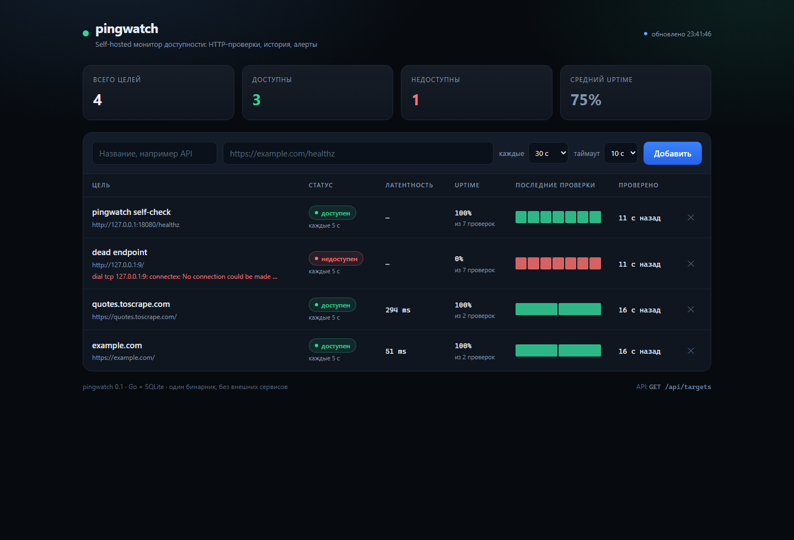

# pingwatch

[](https://github.com/Hopfi3721/pingwatch/actions/workflows/ci.yml)
[](https://github.com/Hopfi3721/pingwatch/releases)
[](LICENSE)
[](go.mod)

**Русский** | [English](README.en.md)

Монитор доступности на Go: периодически проверяет HTTP-эндпоинты, хранит историю
латентности и присылает алерт в Telegram, когда сервис действительно упал —
один раз, а не каждые 30 секунд.



Один бинарник и один файл SQLite. Без Docker, Postgres, Redis и внешних CDN —
запускается командой `go run ./cmd/pingwatch`.

## Что умеет

- **HTTP-проверки** — 2xx/3xx считаются успехом, 4xx/5xx и сетевые ошибки — падением;
  сохраняются код ответа, латентность и текст ошибки
- **Своё расписание у каждой цели** — интервал от 5 секунд до суток, отдельный таймаут
- **Пул воркеров** — медленный сайт занимает один воркер и не задерживает остальные
- **История и статистика** — uptime, средняя латентность, p95, последние проверки
- **Алерты без спама** — машина состояний уведомляет только на переходе
  `up → down` (после N подряд неудач) и `down → up`
- **Telegram и лог** — один и тот же текст уходит во все каналы
- **Переживает рестарт** — состояние алертов восстанавливается из последних
  результатов, повторный DOWN после перезапуска не приходит
- **Дашборд** — встроен в бинарник, обновляется каждые 5 секунд, не тянет
  ничего из интернета
- **Чистка истории** — хранится 5000 последних результатов на цель
- **Graceful shutdown** — сервер и воркеры останавливаются по `Ctrl+C`

## Быстрый старт

```bash
go run ./cmd/pingwatch
```

Открыть <http://localhost:8080>, добавить первый URL в форму. Первая проверка
пройдёт в течение секунды.

### Готовый бинарник

Скачать архив под свою ОС со страницы [releases](https://github.com/Hopfi3721/pingwatch/releases),
распаковать и запустить:

```bash
./pingwatch            # Linux / macOS
./pingwatch.exe        # Windows
./pingwatch --version  # версия сборки
```

### Docker

```bash
docker compose up --build
```

Или готовый образ из GitHub Container Registry:

```bash
docker run -p 8080:8080 -v pingwatch-data:/data ghcr.io/hopfi3721/pingwatch:latest
```

Или вручную из исходников:

```bash
docker build -t pingwatch .
docker run -p 8080:8080 -v pingwatch-data:/data pingwatch
```

## Алерты в Telegram

1. Создать бота у [@BotFather](https://t.me/BotFather) → `/newbot` → получить токен.
2. Написать боту любое сообщение и узнать `chat_id`:
   `https://api.telegram.org/bot<TOKEN>/getUpdates` → `result[0].message.chat.id`.
3. Задать переменные окружения:

```powershell
$env:TELEGRAM_BOT_TOKEN = "123456:ABC..."
$env:TELEGRAM_CHAT_ID   = "123456789"
$env:FAILURE_THRESHOLD  = "3"
go run ./cmd/pingwatch
```

Токен читается только из окружения. Не коммитьте его в репозиторий; если токен
попал в код или переписку — отзовите его через `@BotFather` → **Revoke token**.

Сообщение о падении содержит имя цели, URL, HTTP-код, текст ошибки, число
неудачных проверок подряд, латентность и время. О восстановлении приходит
отдельное сообщение `RECOVERED`.

## API

| Метод | Путь | Описание |
| :--- | :--- | :--- |
| `GET` | `/` | Встроенный дашборд |
| `GET` | `/healthz` | Проверка живости самого pingwatch |
| `GET` | `/api/targets` | Все цели + последний результат каждой |
| `POST` | `/api/targets` | Создать цель |
| `GET` | `/api/targets/{id}` | Цель + последний результат |
| `DELETE` | `/api/targets/{id}` | Удалить цель вместе с историей |
| `GET` | `/api/targets/{id}/results?limit=50` | История проверок (1–500, новые сверху) |
| `GET` | `/api/targets/{id}/stats` | Uptime, средняя латентность, p95 |

### Создать цель

```bash
curl -X POST localhost:8080/api/targets \
  -H 'Content-Type: application/json' \
  -d '{"name":"API","url":"https://example.com/healthz","interval_seconds":30,"timeout_seconds":5}'
```

```json
{
  "id": 1,
  "name": "API",
  "url": "https://example.com/healthz",
  "interval_seconds": 30,
  "timeout_seconds": 5,
  "enabled": true,
  "created_at": "2026-10-28T18:40:19Z",
  "status": "unknown"
}
```

`interval_seconds` по умолчанию `30`, `timeout_seconds` — `10`. Таймаут обязан
быть меньше интервала. Ответ `201 Created` содержит заголовок `Location`.

### Список целей

```bash
curl localhost:8080/api/targets
```

```json
{
  "items": [
    {
      "id": 1,
      "name": "API",
      "url": "https://example.com/healthz",
      "interval_seconds": 30,
      "timeout_seconds": 5,
      "enabled": true,
      "created_at": "2026-10-28T18:40:19Z",
      "status": "down",
      "last_checked_at": "2026-10-28T18:41:20Z",
      "last_status_code": 503,
      "last_latency_ms": 148,
      "last_error": "unexpected status 503 Service Unavailable"
    }
  ]
}
```

У цели без проверок `status` равен `unknown`. Список собирается одним запросом
к последним результатам, без N+1.

### Статистика

```bash
curl localhost:8080/api/targets/1/stats
```

```json
{
  "target_id": 1,
  "total": 100,
  "up": 99,
  "down": 1,
  "uptime_percent": 99,
  "avg_latency_ms": 505,
  "p95_latency_ms": 950,
  "first_checked_at": "2026-10-28T17:00:00Z",
  "last_checked_at": "2026-10-28T18:41:20Z"
}
```

### Ошибки

Все ошибки — JSON вида `{"error": "..."}`:

| Код | Когда |
| :--- | :--- |
| `400` | невалидное тело, пустое имя, не `http(s)` URL, плохой интервал/таймаут, `id` не число, `limit` вне 1–500 |
| `404` | цели с таким `id` нет |
| `405` | метод не поддерживается для этого пути |
| `413` | тело запроса больше 64 KiB |
| `415` | `Content-Type` не `application/json` |
| `500` | внутренняя ошибка (причина пишется в лог) |

## Конфигурация

| Переменная | По умолчанию | Описание |
| :--- | :--- | :--- |
| `ADDR` | `:8080` | Адрес HTTP-сервера |
| `DB_PATH` | `pingwatch.db` | Файл SQLite |
| `WORKERS` | `8` | Сколько проверок выполняется одновременно |
| `FAILURE_THRESHOLD` | `3` | Сколько неудач подряд до алерта |
| `RESULTS_RETENTION` | `5000` | Сколько результатов хранить на цель |
| `TELEGRAM_BOT_TOKEN` | — | Токен бота; без него алерты идут только в лог |
| `TELEGRAM_CHAT_ID` | — | Чат для алертов (обязателен вместе с токеном) |
| `TELEGRAM_API_BASE` | `https://api.telegram.org` | Подмена API для тестов и закрытых контуров |

## Как это работает

```
                   POST /api/targets
                          │
                          ▼
   ┌───────────────┐   ┌─────────┐   ┌─────────────────┐
   │  api          │──▶│ storage │◀──│   scheduler     │
   │ JSON + HTML   │   │ SQLite  │   │ тикер + очередь │
   └───────────────┘   └─────────┘   └────────┬────────┘
                          ▲                   │ Check
                          │ SaveResult        ▼
                          │          ┌─────────────────┐
                          └──────────│    checker      │
                                     │ HTTP 2xx/3xx    │
                                     └────────┬────────┘
                                              │ Result
                                              ▼
                                     ┌─────────────────┐
                                     │ alert + Telegram│
                                     │ только переходы │
                                     └─────────────────┘
```

1. Раз в секунду планировщик смотрит список целей и решает, кому пора
   проверяться: `now - lastCheck >= interval` и цель не в работе прямо сейчас.
2. Готовые цели уходят в буферизованный канал, оттуда их разбирает пул воркеров.
   Если очередь заполнена, тик пропускается — лучше подождать, чем копить долг.
3. Воркер делает HTTP-запрос с таймаутом цели и сохраняет результат.
4. Машина состояний решает, является ли результат новостью. Только тогда
   вызывается уведомление.

## Решения, которые стоит объяснить на собеседовании

**Состояние алертов — отдельная сущность, а не флаг в БД.** `alert.StateMachine`
не знает ни про HTTP, ни про Telegram, поэтому проверяется табличными тестами
без сети и таймеров. Порог, сброс счётчика и восстановление — три ветки, которые
легко сломать молча; здесь они покрыты.

**Одна цель — одна проверка одновременно.** Флаг `inflight` ставится под тем же
мьютексом, что и проверка расписания, иначе два тика подряд отправят одну цель
дважды, и в истории появятся дубли с одинаковым временем.

**Отмена — это не падение.** При остановке сервиса проверка обрывается по
контексту, но результат не сохраняется: иначе в истории появится ложный `DOWN`.
При этом уже полученный результат сохраняется через `context.WithoutCancel`,
чтобы не терять данные при штатном завершении.

**SQLite настроен, а не «просто открыт».** WAL, `busy_timeout=5s`,
`foreign_keys=1`, `MaxOpenConns(1)`. Последнее — сознательный размен: монитор
пишет единицы строк в секунду, зато нет `database is locked` и недетерминированных
тестов. Postgres-адаптер добавляется за тем же интерфейсом `storage.Store`.

**История не растёт бесконечно.** Раз в час удаляются результаты старше 5000
последних на цель — одним запросом с `ROW_NUMBER()`, а не загрузкой всего в память.

**p95 считается по фактическим значениям.** SQLite не умеет percentile, но
`ORDER BY latency_ms LIMIT 1 OFFSET n` даёт нужную точку без вычитывания всей
истории.

## Тесты

```bash
gofmt -l .
go vet ./...
go test -race ./...
```

59 тестовых функций:

- `monitor` — валидация цели (схема URL, границы интервала и таймаута), значения
  по умолчанию, нормализация пробелов
- `storage` — миграции идемпотентны, CRUD, каскадное удаление истории,
  `LatestResults` без N+1, uptime/avg/p95, очистка старых результатов,
  отмена контекста
- `checker` — 200/204/404/500, переход по редиректу, таймаут, отмена,
  недоступный порт, битый URL, отсутствие `User-Agent`-заглушки
- `alert` — порог, отсутствие повторов, восстановление, сброс счётчика,
  изоляция целей, восстановление состояния после рестарта, `Forget`
- `telegram` — корректный путь и тело запроса, `ok:false`, HTTP 401,
  отсутствие токена, настраиваемый `BaseURL`
- `scheduler` — сквозной сценарий с реальным SQLite и фейковым чекером:
  результаты сохраняются, алерт приходит один раз, отключённые цели
  пропускаются, состояние удалённых целей очищается, `Run` завершается по отмене
- `api` — коды `201/200/204/400/404/405/413/415`, `Location`, JSON-ошибки,
  значения по умолчанию, `limit`, пустой список как `[]`, дашборд

Проверено вживую: 3 неудачные проверки подряд при `FAILURE_THRESHOLD=2` дали
ровно один `DOWN` (а не три), затем восстановление дало `UP`.

## Ограничения

Это v0.1 — сознательно узкий срез, а не недоделанный продукт:

- **нет аутентификации** — не выставляйте порт в интернет без reverse proxy
  с Basic Auth или VPN
- одна цель — один HTTP-запрос; за логином, TCP-портом или ping не ходит
- расписание живёт в памяти процесса: два экземпляра на одной базе будут
  проверять цели дважды
- цель нельзя отредактировать — только удалить и создать заново
- нет порогов по коду ответа (`200` именно, а не любой 2xx)
- SQLite — единственный адаптер; Postgres появится в v0.2

## Roadmap

- **v0.2** — адаптер PostgreSQL, редактирование цели, пауза/возобновление,
  проверка TCP-портов
- **v0.3** — Prometheus-метрики, публичная status page, графики латентности
  за 24 часа
- **v0.4** — несколько пользователей, уведомления в вебхук и Slack

## Лицензия

MIT
